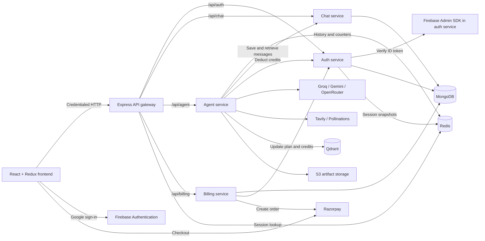
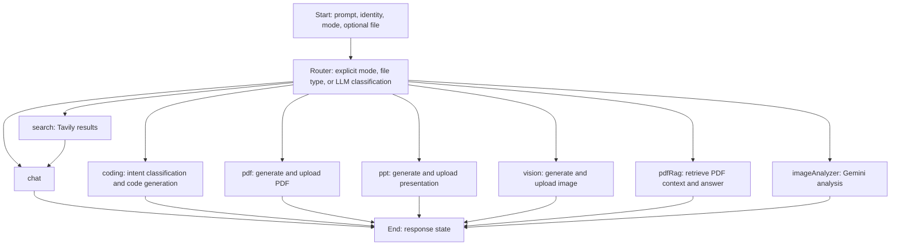
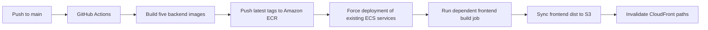

<h1 align="center">SutrAI</h1>

<p align="center">
  A full-stack AI workspace for conversations, web research, code artifacts, and document processing.
</p>

<p align="center">
  
  
  
  
  
  
  
  
  
  
  
  
  
</p>

<p align="center">
  <a href="https://d1tfk8buki9gux.cloudfront.net/">Live demo</a> ·
  <a href="https://github.com/rameshwar0611/SutrAI">Repository</a> ·
  <a href="#system-architecture">Architecture</a> ·
  <a href="#local-development">Local development</a> ·
  <a href="#current-status--future-improvements">Current status</a>
</p>

## Overview

SutrAI brings AI chat, web research, code generation, and document processing into a single React workspace. Users can organize conversations, ask questions about uploaded PDFs and images, inspect generated code, and download generated documents.

Built on the **MERN stack**, the project combines a microservices-style backend with an Express gateway, Firebase identity verification, Redis sessions and memory, and LangGraph routing across specialized AI handlers. PDF questions use **retrieval-augmented generation (RAG)** with Google embeddings and Qdrant; billing connects Razorpay orders to account credits.

Dockerfiles and GitHub Actions define delivery through **Amazon ECR, ECS, S3, and CloudFront**. The sections below explain the implementation, local setup, and remaining improvement areas. Some interface labels and generated documents currently use the name **CortexAI**.

## Key features

### Conversations and workspace

- Create, list, select, and rename conversations; persist user and assistant messages in MongoDB.
- Manage user, conversation, message, artifact, and loading state with Redux Toolkit.
- Render Markdown, tables, syntax-highlighted code, image previews, and copy controls.
- Inspect generated files in a read-only Monaco editor and preview HTML/CSS/JavaScript in a sandboxed iframe.
- Use mobile sidebar/artifact drawers, PDF/image attachments, and browser-dependent speech-to-text input.

### AI and document processing

- Route requests automatically or select a processing mode explicitly.
- Generate conversational answers using Redis-backed history with a chat-service lookup on cache misses.
- Retrieve Tavily web results and pass them to the chat handler for answer synthesis.
- Generate code artifacts or Markdown responses for review, debugging, and explanation requests.
- Answer questions about an uploaded PDF using Google embeddings, Qdrant retrieval, and an LLM.
- Analyze uploaded images with Gemini; generate images through a prompt-expansion and Pollinations pipeline.
- Render generated content as PDFs and presentations, upload artifacts to S3, and return presigned download URLs.

### Identity and billing

- Sign in through Firebase Google authentication and verify the ID token with Firebase Admin.
- Resolve application sessions through an HTTP-only cookie and Redis; forward user identity through the gateway.
- Maintain account plans, credits, and per-user/per-handler request counters.
- Create Razorpay orders, verify checkout signatures using HMAC-SHA256, and update payment records and account credits.

See [Current Status & Future Improvements](#current-status--future-improvements) for work still in progress.

## Technology stack

| Category | Technologies and actual role |
| --- | --- |
| Frontend | React 19, JavaScript/JSX, Vite, Redux Toolkit, Axios |
| Interface | Tailwind CSS, Motion, Lucide, React Markdown, Prism syntax highlighting, Monaco Editor |
| Backend | Node.js ES modules, Express 5, express-http-proxy, Multer, Morgan |
| Persistence | MongoDB and Mongoose for users, conversations, messages, artifacts, and payment records |
| Redis | ioredis client for sessions, conversation memory, and request counters |
| AI orchestration | LangGraph state/conditional edges; LangChain model, message, search, splitting, and vector-store integrations |
| Models and search | Groq, Google Gemini, OpenRouter, Tavily, Pollinations |
| RAG | pdf-parse, RecursiveCharacterTextSplitter, Google embeddings, Qdrant |
| Identity and payments | Firebase Authentication, Firebase Admin, Razorpay |
| Artifact generation | PDFKit, PptxGenJS, AWS SDK for S3 and presigned URLs |
| Packaging and delivery | Docker, GitHub Actions, Amazon ECR/ECS, S3, CloudFront |

## System architecture

The backend contains five Node applications: an API gateway and four domain services, each with its own manifest, entry point, and Dockerfile. Services communicate synchronously over HTTP and share a Redis client module. The diagram shows application connections rather than a verified production network topology.



The gateway applies Redis session middleware to chat, agent, billing, and `/api/me` requests. Its proxy helper forwards the resolved user identity to downstream handlers. Authorization hardening remains part of the improvement work below.

### Service responsibilities

| Component | Responsibility | Source |
| --- | --- | --- |
| Gateway | CORS, cookie parsing, session middleware, proxy routing, request logging | [gateway/index.js](backend/gateway/index.js) |
| Auth | Firebase verification, user provisioning, sessions, plan/credit updates | [auth.controller.js](backend/services/auth/controllers/auth.controller.js) |
| Chat | Conversation and message persistence, including generated artifact files | [chat.controller.js](backend/services/chat/controllers/chat.controller.js) |
| Agent | Multipart uploads, graph invocation, AI integration, artifact processing, message-service calls | [agent.controller.js](backend/services/agent/controllers/agent.controller.js) |
| Billing | Server-defined prices, Razorpay orders, signature verification, payment records | [billing.controller.js](backend/services/billing/controllers/billing.controller.js) |

### Engineering choices and trade-offs

- **Gateway boundary:** Centralizes browser-facing routing and session lookup while keeping domain logic in separate services.
- **MongoDB plus Redis:** Separates durable application records from session snapshots, conversation memory, and request counters.
- **Explicit graph state:** Carries prompt, identity, mode, files, search context, and generated outputs through specialized processing steps.
- **Retrieval before PDF answering:** Supplies relevant document chunks as LLM context instead of relying on the question alone. Model output still requires review.
- **Object storage for generated documents:** PDF/PPT/image handlers upload buffers to S3 and return temporary URLs. Generated code files are embedded in MongoDB messages instead.

## LangGraph AI workflow

The [compiled graph](backend/services/agent/graph/graph.js) begins at a [router](backend/services/agent/graph/router.js). Routing follows this order:

1. Honor an explicit mode other than `auto`.
2. In automatic mode, route PDF uploads to `pdfRag` and images to `imageAnalyzer`.
3. Otherwise, ask the routing LLM to select chat, search, coding, PDF generation, PPT generation, or image generation. Unrecognized labels fall back to chat in the graph.



The controller persists the prompt, invokes the graph, then updates memory and saves the response. Search hands its results to chat; other specialized branches end directly. This is routed workflow orchestration, not autonomous multi-agent collaboration. Responses are returned as complete HTTP responses.

### Provider mapping

| Workload | Provider/model selected in source |
| --- | --- |
| Chat, routing, intent classification, PDF/PPT content, PDF answers, image-prompt expansion | Groq: `openai/gpt-oss-120b` |
| Code generation and coding responses | OpenRouter: `deepseek/deepseek-chat` |
| Uploaded-image analysis | Google: `gemini-2.5-flash` |
| Document embeddings | Google: `gemini-embedding-001` |
| Web retrieval | Tavily search tool, invoked directly by the search handler |
| Image generation | Pollinations endpoint, after LLM prompt expansion |

Model identifiers are configured in [llmModels.js](backend/services/agent/config/llmModels.js) and [embeddings.js](backend/services/agent/config/embeddings.js); provider availability must be checked with the corresponding account.

### PDF RAG pipeline

The [PDF handler](backend/services/agent/agents/pdfRag.agent.js) parses an upload, splits it into 1,000-character chunks with 200-character overlap, embeds them into Qdrant, retrieves five similar chunks, and supplies the context and question to Groq.

Retrieval currently processes the uploaded document for that request; reusable document selection and collection lifecycle management are future improvements.

## Data and Redis usage

| MongoDB model | Stored information |
| --- | --- |
| [User](backend/services/auth/models/user.model.js) | Firebase UID, profile, plan, credits, total credits, expiration, timestamps |
| [Conversation](backend/services/chat/models/coversation.model.js) | Title, user ID, timestamps |
| [Message](backend/services/chat/models/message.model.js) | Conversation reference, role, content, images, embedded artifacts/files, timestamps |
| [Payment](backend/services/billing/models/payment.model.js) | User/order/payment IDs, amount, currency, credits, plan, status, timestamps |

Redis stores seven-day application sessions, caches conversation history with chat-service lookups on misses, and maintains per-user/per-mode request counters. Counter settings use a 60-second window with 20 chat checks or five checks for other configured categories. Search also passes through chat. Cache lifecycle and consistent limit handling remain improvement areas; no performance benchmark is claimed.

## Repository structure

```text
SutrAI/
├── .github/workflows/deploy.yml
├── backend/
│   ├── package.json                 # Shared ioredis dependency
│   ├── docker-compose.yml           # Redis only
│   ├── gateway/
│   │   ├── controllers/
│   │   ├── middleware/
│   │   ├── utils/
│   │   ├── Dockerfile
│   │   └── index.js
│   ├── shared/redis/redis.js
│   └── services/
│       ├── auth/                    # Controllers, routes, model, config, Dockerfile
│       ├── chat/                    # Controllers, routes, models, config, Dockerfile
│       ├── billing/                 # Controllers, routes, model, plans, Dockerfile
│       └── agent/
│           ├── agents/              # Eight specialized processing handlers
│           ├── config/              # Models, memory, rate checks, uploads, integrations
│           ├── controllers/
│           ├── graph/               # State, router, compiled workflow
│           ├── routes/
│           ├── utils/               # PDF/PPT rendering, S3, service-call helpers
│           ├── temp/                # Upload directory; contains sample images
│           ├── Dockerfile
│           └── index.js
└── frontend/
    ├── public/
    ├── src/
    │   ├── assets/
    │   ├── components/
    │   ├── features/                # API request helpers
    │   ├── pages/
    │   ├── redux/
    │   ├── App.jsx
    │   └── main.jsx
    ├── utils/                       # Axios and Firebase clients
    └── vite.config.js
```

## Local development

### Prerequisites

- Node.js **24.x** and npm; the repository does not pin a Node version.
- A running MongoDB instance and Redis instance; Qdrant is additionally needed for PDF RAG.
- Firebase Google sign-in configuration and the matching Firebase Admin service-account file.
- Groq, Google AI, OpenRouter, and Tavily API credentials for the eagerly imported AI integrations.
- Razorpay **test-mode** credentials for billing development.
- AWS S3 configuration and credentials for PDF, PPT, and generated-image storage.

Agent and billing integrations initialize at import time, so their credentials can be required at startup even when a feature is not selected.

### 1. Clone and install

Run from a Bash-compatible shell:

```bash
git clone https://github.com/rameshwar0611/SutrAI.git
cd SutrAI

for directory in backend backend/gateway backend/services/auth backend/services/chat backend/services/agent backend/services/billing; do
  (cd "$directory" && npm ci) || exit 1
done

cd frontend
npm ci --legacy-peer-deps
cd ..
```

Install the backend root package for shared `ioredis` imports. The frontend flag accommodates peer-dependency entries missing from the current lockfile without rewriting it.

### 2. Prepare databases and configuration

Start your MongoDB instance; see the [MongoDB installation guide](https://www.mongodb.com/docs/manual/installation/) if needed. The repository's Compose file can provide Redis:

```bash
docker compose -f backend/docker-compose.yml up -d redis
```

Provision Qdrant separately using its [quickstart](https://qdrant.tech/documentation/quickstart/) for PDF RAG. Compose includes neither MongoDB nor Qdrant; the current adapter accepts a Qdrant URL but does not configure API-key authentication.

Create the per-directory `.env` files shown in the [environment reference](#environment-variable-reference), replace credential placeholders privately, and place the Firebase Admin JSON at `backend/services/auth/serviceAccountKey.json`. Environment files and this credential filename are ignored by Git; do not commit them.

The [Firebase client](frontend/utils/firebase.js) contains fixed metadata for project `sutrai`. Another project requires a separate client-configuration update, Google sign-in activation, and authorization of the intended browser domain.

### 3. Start the services

Open a separate terminal for each component. Run commands from the repository root:

| Component | Command |
| --- | --- |
| Auth | `cd backend/services/auth && node --env-file=.env index.js` |
| Chat | `cd backend/services/chat && node --env-file=.env index.js` |
| Agent | `cd backend/services/agent && node --env-file=.env index.js` |
| Billing | `cd backend/services/billing && node --env-file=.env index.js` |
| Gateway | `cd backend/gateway && node --env-file=.env index.js` |
| Frontend | `cd frontend && npm run dev -- --host localhost --port 5173 --strictPort` |

`--env-file` loads configuration before imported clients initialize. Package scripts `npm start` and `npm run dev` are also available when variables are already loaded.

With the example values below, the frontend is at `http://localhost:5173` and the gateway at `http://localhost:8000`. Match `FRONTEND_URL` to the browser origin and keep backend services on a trusted development network.

**Browser authentication:** Sessions use `Secure; HttpOnly; SameSite=None` cookies. Use trusted HTTPS frontend/gateway endpoints for consistent behavior and update URL settings and Firebase's authorized domain accordingly. HTTP localhost behavior varies by browser; an HTTPS proxy is not included.

### 4. Check configuration and available commands

- `GET /` on each backend is a greeting endpoint, not a database/integration health check.
- `GET /api/me` on the gateway requires a valid application session.
- After sign-in, verify conversation creation, a chat response, and message retrieval before testing search, RAG, artifacts, or checkout.
- In `frontend/`, `npm run build` builds the client, `npm run preview` serves the build, and `npm run lint` runs ESLint. Existing lint findings remain; there is no application test suite or CI test gate in the repository.

## Environment variable reference

Create these files manually using local settings and private credential values; `.env.example` files are not included. Examples contain **placeholders only for credentials**. Never commit `.env` files or private JSON keys, and never put private credentials in browser-exposed `VITE_` variables.

<details>
<summary><strong>Frontend — frontend/.env</strong></summary>

```dotenv
VITE_SERVER_URL=http://localhost:8000
VITE_FIREBASE_API_KEY=<firebase-web-api-key-for-the-configured-project>
VITE_RAZORPAY_KEY_ID=<razorpay-test-key-id>
```

Use the matching public Razorpay test key ID; its secret belongs only in billing.

</details>

<details>
<summary><strong>Gateway — backend/gateway/.env</strong></summary>

```dotenv
PORT=8000
FRONTEND_URL=http://localhost:5173
REDIS_URL=redis://localhost:6379
AUTH_SERVICE=http://localhost:8001
CHAT_SERVICE=http://localhost:8002
AGENT_SERVICE=http://localhost:8003
BILLING_SERVICE=http://localhost:8004
```

</details>

<details>
<summary><strong>Auth — backend/services/auth/.env</strong></summary>

```dotenv
PORT=8001
MONGODB_URI=mongodb://localhost:27017/sutrai
REDIS_URL=redis://localhost:6379
```

Also provide `backend/services/auth/serviceAccountKey.json` privately; Firebase Admin reads this file directly.

</details>

<details>
<summary><strong>Chat — backend/services/chat/.env</strong></summary>

```dotenv
PORT=8002
MONGODB_URI=mongodb://localhost:27017/sutrai
```

</details>

<details>
<summary><strong>Agent — backend/services/agent/.env</strong></summary>

```dotenv
PORT=8003
MONGODB_URI=mongodb://localhost:27017/sutrai
REDIS_URL=redis://localhost:6379
AUTH_SERVICE=http://localhost:8001
CHAT_SERVICE=http://localhost:8002

GROQ_API_KEY=<groq-api-key>
GOOGLE_API_KEY=<google-ai-api-key>
OPENROUTER_API_KEY=<openrouter-api-key>
TAVILY_API_KEY=<tavily-api-key>
QDRANT_URL=http://localhost:6333

AWS_REGION=<aws-region>
AWS_ACCESS_KEY_ID=<aws-access-key-id>
AWS_SECRET_KEY=<aws-secret-access-key>
AWS_BUCKET_NAME=<artifact-bucket-name>
```

AI/search keys use the LangChain adapters' environment defaults. The S3 client specifically reads `AWS_SECRET_KEY`; retain that exact name. Agent startup also initializes MongoDB.

</details>

<details>
<summary><strong>Billing — backend/services/billing/.env</strong></summary>

```dotenv
PORT=8004
MONGODB_URI=mongodb://localhost:27017/sutrai
AUTH_SERVICE=http://localhost:8001
RAZORPAY_KEY_ID=<razorpay-test-key-id>
RAZORPAY_KEY_SECRET=<razorpay-test-key-secret>
```

Use a matching test-mode key pair. Billing implements order-based credit purchases, not recurring subscriptions.

</details>

Ports match the Dockerfiles; listeners read `PORT`. The shared database name is a local example. Keep Redis and inter-service URLs consistent across processes.

## Docker and AWS deployment

Each Dockerfile uses `backend/` as its build context to include shared modules and the selected service. From the repository root:

```bash
docker build -f backend/gateway/Dockerfile -t gateway backend
docker build -f backend/services/auth/Dockerfile -t auth-service backend
docker build -f backend/services/chat/Dockerfile -t chat-service backend
docker build -f backend/services/agent/Dockerfile -t agent-service backend
docker build -f backend/services/billing/Dockerfile -t billing-service backend
```

Supply runtime variables, service/database URLs, and private credential files separately. Replace `localhost` with reachable service addresses inside containers. Compose defines Redis only.

The repository defines the following release path:



The diagram follows [workflow commands](.github/workflows/deploy.yml), not a verified production topology. ECR repositories, ECS services/task definitions, IAM, networking, S3, and CloudFront must already be provisioned; launch type and load-balancer configuration are not defined here. Artifact storage uses `AWS_BUCKET_NAME`, while frontend deployment uses `S3_BUCKET`.

Keep real Firebase keys out of image build contexts and provide them through a private runtime file mount. Runtime credential mounting is not defined in this repository. Image reproducibility, runtime hardening, and health checks remain future improvements.

## GitHub Actions CI/CD

The [SutrAI Deployment workflow](.github/workflows/deploy.yml) runs on pushes to `main`:

1. **Backend job:** Checks out source, configures AWS credentials, logs in to ECR, builds/tags/pushes gateway/auth/chat/agent/billing images, and invokes ECS force-deployment commands.
2. **Frontend job:** Depends on backend job completion, installs/builds the Vite application, uploads `frontend/dist` to S3 with `--delete`, and invalidates CloudFront paths.

This is deployment automation without test/lint gates, service-stability checks, or automated rollback. Successful release behavior requires separate verification.

<details>
<summary><strong>GitHub Actions secret names referenced by the workflow</strong></summary>

| Group | Exact names |
| --- | --- |
| AWS authentication | `AWS_ACCESS_KEY`, `AWS_SECRET_ACCESS_KEY`, `AWS_REGION`, `AWS_ACCOUNT_ID` |
| Existing ECS targets | `ECS_CLUSTER`, `GATEWAY_SERVICE`, `AUTH_SERVICE`, `CHAT_SERVICE`, `AGENT_SERVICE`, `BILLING_SERVICE` |
| Frontend build settings | `VITE_FIREBASE_API_KEY`, `VITE_RAZORPAY_KEY_ID`, `VITE_SERVER_URL` |
| Frontend delivery targets | `S3_BUCKET`, `CLOUDFRONT_DISTRIBUTION_ID` |

Workflow service secrets identify ECS services; application variables with the same names are HTTP URLs. Configure backend runtime variables and private files separately.

</details>

## Screenshots

Application screenshots are not included yet. Existing images are decorative assets or upload samples, not UI captures. Explore the [live demo](https://d1tfk8buki9gux.cloudfront.net/) for the interface; screenshots can be added when suitable captures are available.

## Current Status & Future Improvements

SutrAI implements the workflows described above and continues to evolve as an engineering portfolio project. The demo link is provided for exploration; integration availability and deployment health are not guaranteed by this documentation.

- **Security and identity:** Authorization boundaries, session lifecycle, credential handling, and input validation need further hardening. These remain unresolved engineering work.
- **Billing reliability:** Improve payment reconciliation, consistent credit accounting, and account lifecycle handling before relying on the integration for live billing.
- **AI and data lifecycle:** Improve cache consistency, request-limit handling, structured-output validation, and reusable PDF retrieval with collection cleanup.
- **Developer experience and operations:** Add automated tests, CI quality gates, deployment checks, reproducible images, and consistent error handling; reconcile dependency metadata and branding.

The project does not claim autonomous multi-agent collaboration, streaming responses, measured production-scale performance, or production readiness. Recurring subscriptions and reusable document retrieval are not currently implemented.
